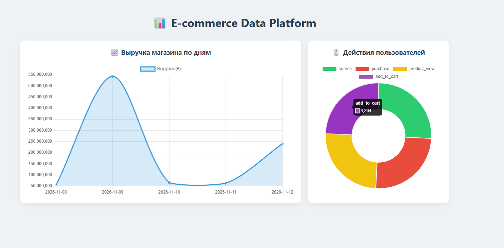

# 🛒 E-Commerce Data Platform (Pet-Project)

Полноценная Data Engineering платформа, имитирующая работу крупного интернет-магазина. Проект включает в себя пакетную (Batch) и потоковую (Streaming) обработку данных, оркестрацию, Data Lake и визуализацию.

## 🏗 Архитектура
1. **Источники данных (OLTP):** PostgreSQL (заказы, клиенты, товары).
2. **Потоковые данные:** Apache Kafka (клики пользователей в реальном времени).
3. **Data Lake (Bronze):** MinIO (S3-совместимое хранилище) с файлами Parquet.
4. **Обработка (Silver/Gold):** dbt (SQL-модели) и Apache Spark (тяжелая агрегация).
5. **Оркестрация:** Apache Airflow (запуск пайплайнов по расписанию).
6. **Serving:** FastAPI + HTML/JS (Дашборд).



## 🚀 Как запустить проект локально
1. Клонируйте репозиторий.
2. Создайте файл `.env` (пример в `.env.example`).
3. Запустите инфраструктуру:
   ```bash
   docker compose up -d
   docker compose -f docker-compose-airflow.yml up -d